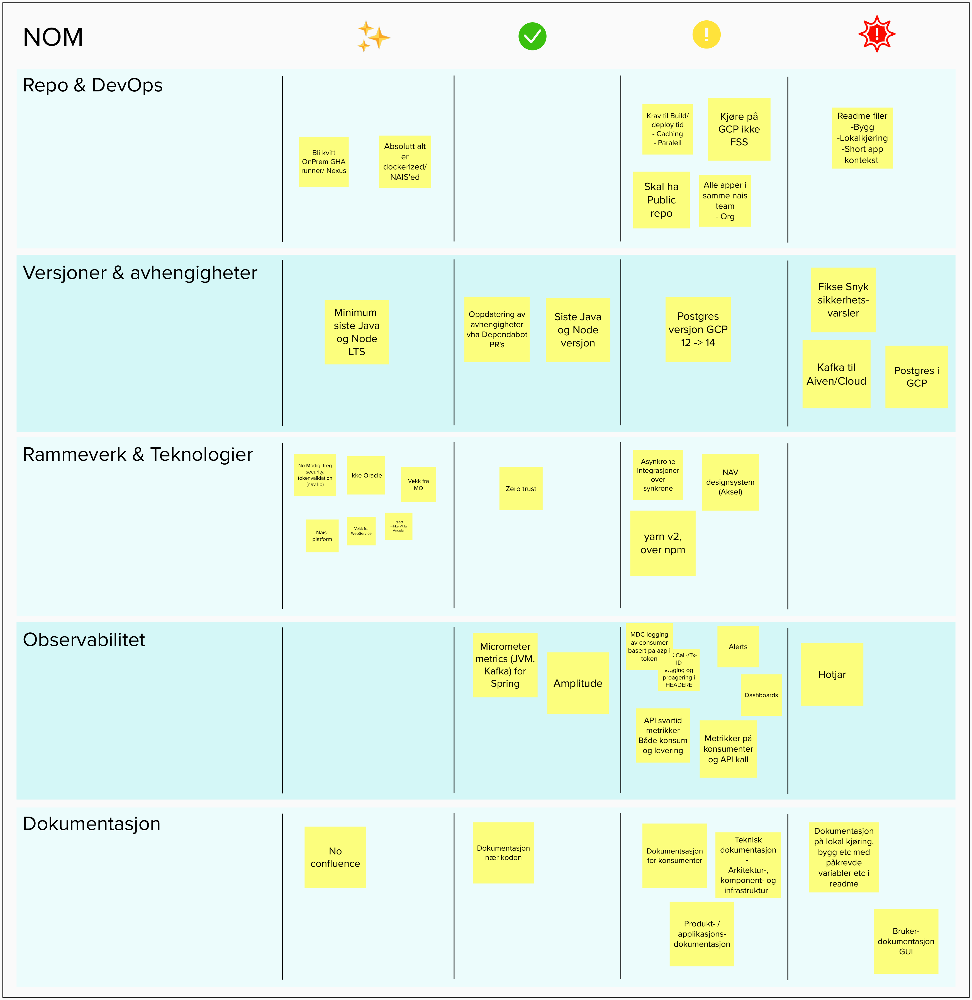

:sectnums:
:sectanchors:
:toc: left
:toclevels: 2
:toc-title: Innhold
:icons: font

= Applikasjoner

== State of the union

Delt i oversikten på https://navikt.github.io/team-org/#_state_of_the_union

.https://app.mural.co/t/navdesign3580/m/navdesign3580/1663915979459/f20b9753c02fe87df9060620e7fb08691fe7fbcd?wid=0-1664202118790&outline=open[Orginalmatrise på Mural]

== NOM-Api

Integrasjonspunkt for konsumenter utenfor NOM, og NOM-Ui.
Eksponerer GraphQL for å hente informasjon fra NOM.

== NOM-PROXY

Står for kommunkasjonen mellom NOM og onprem services som datavarehus og AD.
DVH eksponerer noen endepunkter via tdv der hvor de gir oss opplysninger rundt enheter og ressurser.
Disse opplysningene er igjen hentet fra eksterne kilder som Agresso, Norg, +++.
På sikt, er det tenkt at NOM blir master for en del av disse opplysningene og at DVH får det fra oss i stede for alle disse andre spredte kildene.

Endepunktene NOM proxy eksponerer blir konsumert (polling) av enten NOM-Ressurser eller NOM-API, der førstnevnte bruker et offset basert endepunkt, mens sistnevnte bruker snapshots og gjør en diff-jobb selv for å trekke ut hvilke

Informasjon hentes fra DVH via feeds som baserer seg på et offset, f.eks 10101920, der hvor man etterspør alle rader etter dette.
Dataen blir så lagret på Kafka for at vi kan benytte i andre applikasjoner.

Offset blir lagret sammen med dataen, slik at ved oppstart av applikasjonen så vil man laste inn alle records og beholde det siste offsettet innenfor typen.
F.eks:

[source]
----
Key: Enhet-9238823, Value: { "offset": 9238823..... }
Key: Enhet-9238824, Value: { "offset": 9238824..... }
Key: Ressurs-102939, Value: { "offset": 102939..... }
----

Spiller man av Kafka topicen fra begynnelsen og opp til topp, så sitter man igjen med offset for `enhet=9238824` og `ressurs=102939`.

Data lagres på Kafka topicen: `aapen-nom-dvhSource-v1`.

== NOM-Ui

Frackend (backend for frontend) for ui delen av NOM.
Holder på sessjoner for bruker og proxyer kall videre til eventuelle nedstrøms-tjenester.
Proxy benyttes for å støtte accessPolicies mellom applikasjoner, pluss at man må bytte ut token til et `on-behalf-of` token som har audience den appen man kontakter.

include::nav-ident.adoc[leveloffset=+1]

== Lokal utvikling mot miljø

Man må være tilkoblet naisdevice for å kunne kjøre lokalutvikling mot miljø.

* NOM-UI frackend må startes først:
** Kopier teksten i filen `apps/ui/src/main/resources/application-local-template.yaml` til en ny fil `application-local.yaml` i samme mappe
** Sett inn oppdaterte AAD credentials i `application-local.yaml`. Hentes i clusteret, gjerne med et script.
** Start ui lokalt, med profiles `log-console,local,dev`
** Hvis UI f.eks kjører på port 8080, gå til https://localhost:8080/login og logg inn med trygdeetaten bruker, enten din egen eller bruker generert i https://ida.intern.nav.no
** UI Frackend vil nå gjøre API kall direkte mot miljø via naisdevice.
* Deretter kan react-dev server kjøres opp
** kjør `npm install` i apps/ui/src/main/webapp/
** kjør `npm run start` i samme mappe
** api kall gjort mot react dev server proxies videre til frackend

Se fulle navn i hva som benyttes i vanlig property filen til nom-ui (altså som kommer fra Kubernetes i miljø).
Aktiver så profile local i IntelliJ og kjør eventuelt `port-forward` (se annet kapittel for kommando, søk i dokumentet) for å få tiltang til ressurser i dev.

Hvis man går mot miljø, husk å oppdatere base-paths for tjenestene man benyttes til å matche hva man har port-forwarda til.
F.eks, `api.base-base: localhost:8081`.

=== How to run locally
1. Spin up docker-containers with `docker-compose up -d` located in project-root.
2. In IntelliJ, go to Run/Debug Configuration and assign `local` as your Active profile.

En midlertidig feil med docker-oppsettet er at kafka topic på en ny container ikke opprettes før første melding på topicet er sendt.

=== Hvordan benytte pgAdmin lokalt
pgAdmin er satt opp lokalt på adressen http://localhost:8089/ med bruker/passord = `user@domain.com/password`.
For å nå en lokal nom database velg 'Create server' og gi den ett navn på 'General' tabben.
På 'Connection' tabben sett opp følgende:

[source]
----
Host name:  enhet-db/ressurs-db/skjermet-db (velg en)
port: 5432/5433/5434 (henholdsvis)
Maintenance database: postgres-enheter/postgres-ressurs/postgres-skjermet (henholdsvis)
Username: postgres
Password: password
----
Kryss gjerne av for lagre passord.

På 'Advanced' tabben må 'Host Address' være ip adressen til maskinen din. Eksempelvis 192.168.39.139. Altså ip adressen til docker host. Dette kan ikke være localhost referanse, for det vil bare peke på ip adressen som pgAdmin docker container har fått.

pgAdmin har fått en docker volume for config oppsett slik at denne konfigurasjonen persisteres mellom hvar gang men kjører opp lokalmiljøet.

=== Bygg og test på MAC med Colima og uten Docker Client

`org.testcontainers` klarer ikke ut av boksen å benytte Colima docker.

Lag filen: ~/.testcontainers.properties

[source]
----
docker.host=unix\:///Users/g155033/.colima/docker.sock
docker.tls.verify=0
----
host referansen finner du med:
`docker context ls`

Eks:

[source]
----
❯ docker context ls
NAME       DESCRIPTION                               DOCKER ENDPOINT                             KUBERNETES ENDPOINT                        ORCHESTRATOR
colima *   colima                                    unix:///Users/g155033/.colima/docker.sock
default    Current DOCKER_HOST based configuration   unix:///var/run/docker.sock                 https://apiserver.prod-fss.nais.io (org)   swarm
----

Til slutt må Ryuk skrus av siden den vil ha elevated rettigheter for å rydde bort testcontainere. Sett følgende environment variable:
`TESTCONTAINERS_RYUK_DISABLED=true`
