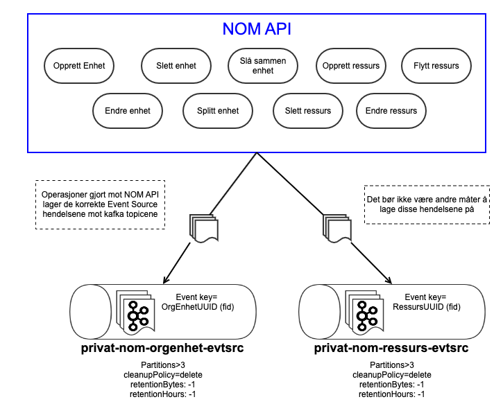
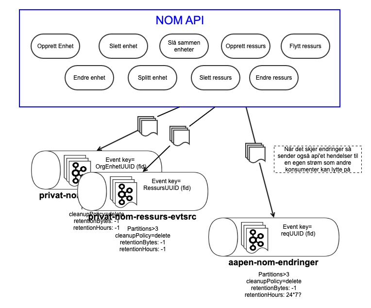
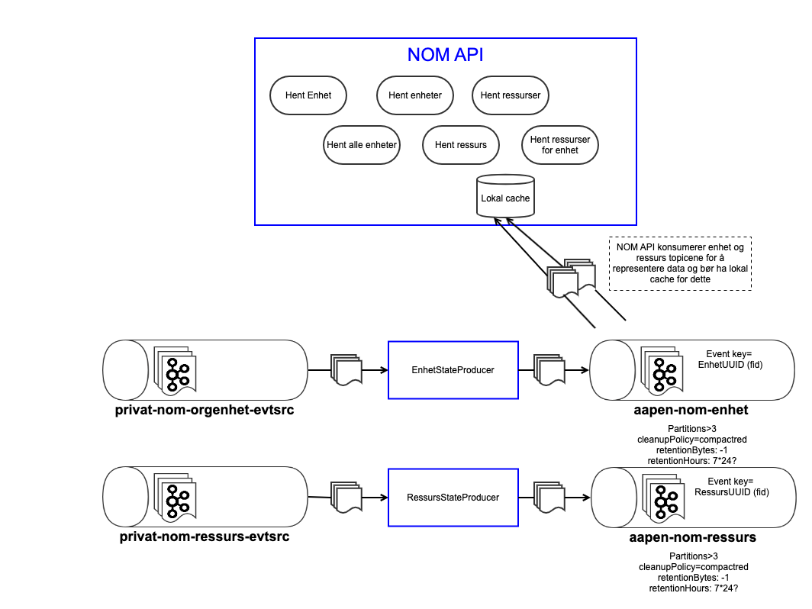
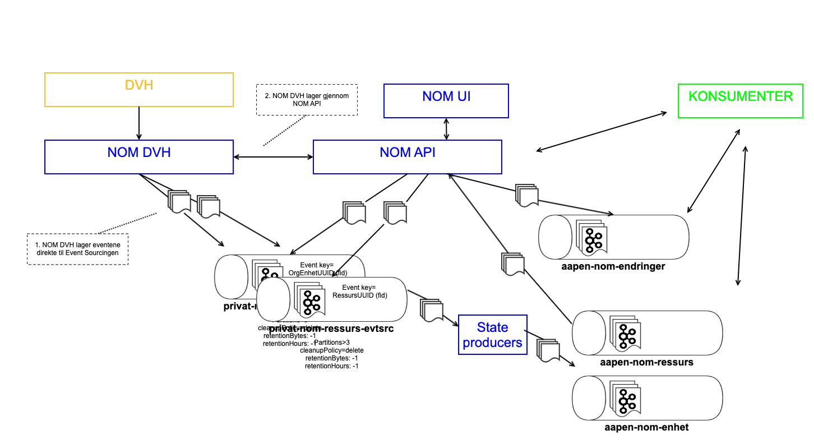

= Roy's input på event sourcing hendelser og arkitektur
:sectanchors:
:toc: left
:toclevels: 2
:toc-title: Innhold
:icons: font

(Bilder vedlikeholdt i Gliffy på Confluence link:https://confluence.adeo.no/display/~G155033/NOM+tegninger[her] )

WARNING: Under arbeid

== Generelt

Event sourcing som basis for persistens, med seperasjon av skriv og les på modell/data (cqrs).

== Event sourcing av hendelse data til Kafka

En topic per aggregate, med event key lik den funksjonelle ID'en til aggregaten.

[NOTE]
====
Ingenting utenfor en aggregate vil ikke ha referanser til noe inne i en aggregate. Kun til selve aggregaten i seg selv.
Dette gir fordelen av at endringer utenfor ikke påvirker aggregaten og vica verca.
[qoute, Uncle Bob, https://martinfowler.com/bliki/DDD_Aggregate.html]
____
A DDD aggregate is a cluster of domain objects that can be treated as a single unit
____
====

== Event/hendelses object

.Event sourcing hendleses stuktur
[source, json]
----
{
    "id": "fd3b3bdf-6b45-4618-ba31-ee014d62e089",
    "reqId": "2f93c50a-7a74-11eb-9439-0242ac130002",
    "type": "OPPRETTET",
    "opprettetAv":"G155033",
    "timestamp":"2020-11-24T13:37:00Z",
    "payload": {
        "type":"no.nav.nom.hendelse:EnhetEvtSrc",
        "data": "<Enhet - Event source - Json data>"
    }
}
----

Når det gjelder type hendelse her så tror jeg ikke det er noe vits å skille på om det er en endring eller korreksjon etc. Dette er uansett intern NOM informasjon, og API'et vil gjerne ikke vite forskjellen uansett. Og en bruker som korrigerer en informasjon forholder seg ikke til hendelsene, og får ikke spesifisert hvilken hendelse som korrigering eller annulering tilhører.

Det eneste jeg kan se for meg er evt. administrative korreksjoner foretatt av oss på dataene. F.eks. om vi må kansellere ett sett med hendelser som er utført.

=== Organisasjons enhet

Enhet består av informasjon om enheten, denne enhetens gyldighetsperiode(r?) og enhetens knytning til en annen enhet som underenhet og i hvilke perioder.

.Enhet - Event sourcing payload data
[source, json]
----
{
    "fid": "73b41c29-3a70-4295-a084-535a3263e211",
    "navn": "NAV Sagene",
    "type": "Nav kontor",
    "norgId": "0314",
    "agressoId": "0314001",
    "gyldighetsperiode": [
        { "fom":"2010-01-01" }
    ],
    "overordnetEnhet": [
        {
            "fid": "5a17ec4e-4b15-4bab-b647-4d71b235c92a",
             "gyldighetsperiode": {
                "fom":"2010-01-01",
                "til":"2014-05-31"
            }
        },
        {
            "fid": "e949699a-6538-4ea2-860a-539fae41c272",
            "gyldighetsperiode": {
                "fom":"2014-06-01"
            }
        }
    ]
}
----

Selve hendelses dataene behøver ikke inneholde mer enn selve endringen. F.eks. om navn på enhet er endret så er det kun behov for at dataene inneholder fid og navn.

=== Ressurs

Ressurs er en ansatt, innleid etc person som utfører arbeid i NAV.

.Ressurs - Event sourcing payload data
[source, json]
----
{
    "fid": "b9451eba-1409-46ef-b6ac-fcfceae4c944",
    "fnr": "07087225111",
    "navn": "Roy Grini",
    "navIdent": "g155033",
    "lederFor": [
        {
            "fid": "5a17ec4e-4b15-4bab-b647-4d71b235c92a",
            "periode": {
                "fom":"2017-01-01",
                "til":"2017-02-01"
            }
        }
    ],
    "knytning": [
        {
            "fid": "5a17ec4e-4b15-4bab-b647-4d71b235c92a",
            "type": "Innleid",
            "periode": {
                "fom":"2012-05-01",
                "til": "2014-05-01"
            }
        },
        {
            "fid": "5a17ec4e-4b15-4bab-b647-4d71b235c92a",
            "type": "Fast ansatt",
            "periode": {
                "fom":"2014-05-01"
            }
        }
    ],
    "personalleder":[
        {
            "fid": "ec9c94a3-80ee-44cb-aeaa-9e6d04f5cf63",
            "periode": {
                "fom": "2014-05-01",
                "til": "2017-01-01"
            }
        },
        {
            "fid": "ec9c94a3-80ee-44cb-aeaa-9e6d04f5cf63",
            "periode": {
                "fom":"2017-01-01",
                "til":"2017-02-01"
            }
        },
        {
            "fid": "ebb23acf-5920-4bb8-aebe-971c5d5fbc36",
            "periode": {
                "fom": "2017-02-01"
            }
        }
    ]
}
----

Slik som for enhet trenger man kunn å levere endringsdataene i hendelsen, og ikke et komplett ressurs objekt.

== Forretningshendelser

Konsumenter ønsker kanskje å vite når det gjøres endringer på ulike objekter i NOM. API'et bør da også lage hendleser på en egen kafka strøm for å representere operasjoner. Denne strømmen trenger ikke å ha evig retention, og vil heller ikke ha compaction.

Her må det gjøres vurderinger på hvordan disse hendelsene skal være.
Det bør kanskje være kun en hendelse for en logisk operasjon foretatt mot API'et, hvor innholdet er beskriver hva som er gjort og hvilke objekter det har berørt.
Det blir kanskje veldig komplisert å ivareta en fullstendig informasjon om hva og hvordan data har endret seg (CDC)

Siden dette vil benyttes av konsumenter må det tenkes godt igjennom hva som lages her, slik at vi slipper store problemer ved endringer i API og system.

=== Forretningshendelse data

En unik id for hver hendelse, denne kan være samme id som da er benyttet som reqId på event source hendelsene. Kanskje også ta med en 'fritekst' liknende informasjon om selve input parameterene til API kallet. Men dette bør ikke være data som konsumenter skal benytte for å avgjøre behandling. Dette er mer for debugging og informasjon for forståelse og bør kunne endres i struktur av oss når vi måtte trenge.

.NOM endringshelndelser
[source, json]
----
{
    "id": "fd3b3bdf-6b45-4618-ba31-ee014d62e089",
    "hendelse": "SlaaSammenEnheter",
    "opprettetAv":"G155033",
    "timestamp":"2020-11-24T13:37:00Z",
    "beroerteEnheter": [
      { "fid": "ec9c94a3-80ee-44cb-aeaa-9e6d04f5cf63" },
      { "fid": "a2db7cad-9401-40f9-8e8e-0c2fb2d90720" }
    ],
    "beroerteRessurser": [
        { "fid": "b9451eba-1409-46ef-b6ac-fcfceae4c944" },
        { "fid": "f598ffec-d0fa-4b9b-8d70-b1ee81e34dec" },
        { "fid": "82d6fd8f-569b-4c35-839d-b27fef411a23" },
        ...
    ],
    "ustrukturertInfo": {
        "apiMetode": "mergeEnheter",
        "parameter": {
            "utgaaendeEnhet": "ec9c94a3-80ee-44cb-aeaa-9e6d04f5cf63",
            "mottakendeEnhet": "a2db7cad-9401-40f9-8e8e-0c2fb2d90720",
            "flyttRessurserTilMottakendeEnhet": "true",
            "gjelderFra": "2019-06-01"
        }
    }
}
----

== Projeksjoner for å lese data fra NOM

Event source hendelsene er i lite egnet for å representere data ut til konsumenter gjennom et API eller en kafka topic. Her behøves state/snapshot til objektene, og ikke hendelsen i seg selv. Og det er state/snapshot som er mest interresant. Dette vil inneholde funksjonell historikk, men ikke teknisk. Om det er behov for teknsisk historikk på noe tidspunkt, så tar vi det da og ikke nå. Vi har uansett grunnlaget i event sourcingen.

Vi bør ha en compacted kafka topic for hver av Enhet og Ressurs. Og disse objektene kan ha mer informasjon populert på objektene. For å lage disse projeksjonene må vi ha egne konsumenter som lytter på event source strømmene for å produsere hendelser hit (eller funker det kanskje å lage kafka streams?).

== Situasjon mens DVH er master av data

== Innspill, innvendinger og spørsmål under møtet i dag (2.mar.21)

. Hvorfor flere topics for event sourcing?

 Jeg synes det er naturlig kunne dele dette opp på en slik måte. Ser ikke noe bestemt grunn til at det ikke skal gjøres. Men dette er ikke noe jeg mener er påkrevd, så man kan gjerne ha det i en og samme topic.
 /Roy

. Men hva med rekkefølge på eventene når de er delt på to topics

 Rekkefølge leveranse på events er kun garantert innenfor en partisjon i en topic. Og vi bør sette opp med flere partisjoner med en gang. Og det må være minst like mange partisjoner som det finnes konsumnetrer i samme konsumentgruppe. Det vil si at hvis man ønsker å fyre opp tre podder for å lese topicen i parallell, så må det være minst tre partisjoner. Ja, man kan starte med en partisjon, og utvide med flere etter hvert. Men eksisterende eventer i topicen vill ikke flyttes til noen ny partisjon (i.e. spre events jevnt på partisjonene), så man vil ha denne ubalansen for alltid etterpå.
 Vi ønsker å ha rekkefølge på eventen innenfor et aggregate object, så vi bør (må?) ha event nøkkel lik funksjonell nøkkel siden dette bestemmer hvilken partisjon ting havner i.
 /Roy

. Hvorfor ikke la event source topics være åpne for konsumenter

 Enkapsulering. Når vi benytter event sourcing og CQRS så skiller vi på skriv og les domene. Konsumenter skal da ha domene modell for les, og ikke skriv modellen vi benytter i selve event source'n. Vi slipper også å risikere at konsumentene sine behov sniker seg inn i event source modellene.
 Samtidig vil vi ha større fleksibilitet til å endre eventsource modellen og dataene etter vårt behov uten å måtte ta direkte hensyn til konsumentene.
 Men - det er ikke noe stort krav for meg dette. Og antaglig det raskeste og beste å starte med, inntill vi virkelig erfarer hva behovene er. Men er det åpent med konsumenter på, så er det vanskelig å lukke på et senere tidspunkt hvis det finnes konsumenter på topicen.
 /Roy

. Når 'NOM applikasjonen' starter opp vil den re-lese event sourcen fra start og bygge opp domenedataene

 Slik jeg forstår så i PDL så leses hele eventsourcen på oppstart og domene objektene lages basert på dette. Domenedataene er vel i hovedsk snapshot objekter? Og i tillegg så produseres det livshendelser på en egen kø, så applikasjonen må ta vare på offset av hvor langt den har kommet i eventsourcen for å lage disse livshendelsene uten å produsere alle på nytt?
 Jeg synes det er best å fortløpende ha en snapshot projeksjon av objektene i en log compacted kø som produseres fortløpende. Dette er automatisk hovedkilden for konsumenter for å lytte på endringer, kilden som NOM API leser fra. Også GraphQL spørringene.
 /Roy

. Det kan være viktig for forretning å skille mellom korreksjon og endring

 Jeg er som nevnt tidligere usikker på om det er behov for å skille mellom en korreksjon og en endring på eventsource hendelsene. Hvis man har ett forretningsmessig behov å ta vare på perioden en enhet hadde ett navn, og en periode den hadde ett annet navn. Da må vi ta vare på dette i evnentsource objektet som en funkjsonell historikk, med periodiseringen. Ikke skjult i eventhistorikken som kun bør dekke teknisk historie.
 Hva annulering, opphørt og andre mulige event typer er jeg litt usikker på skal dekke. Annulering av en endring, er vel å endre tilbake. Annulering av opprett er vel en slett. Opphør av en stilling høres ut for meg som sluttdato på ressursens stilling som er i den funksjonelle historikken.
 Jeg stemmer for event source typer begrenses til Opprettet, Endret og Slettet.
 /Roy

